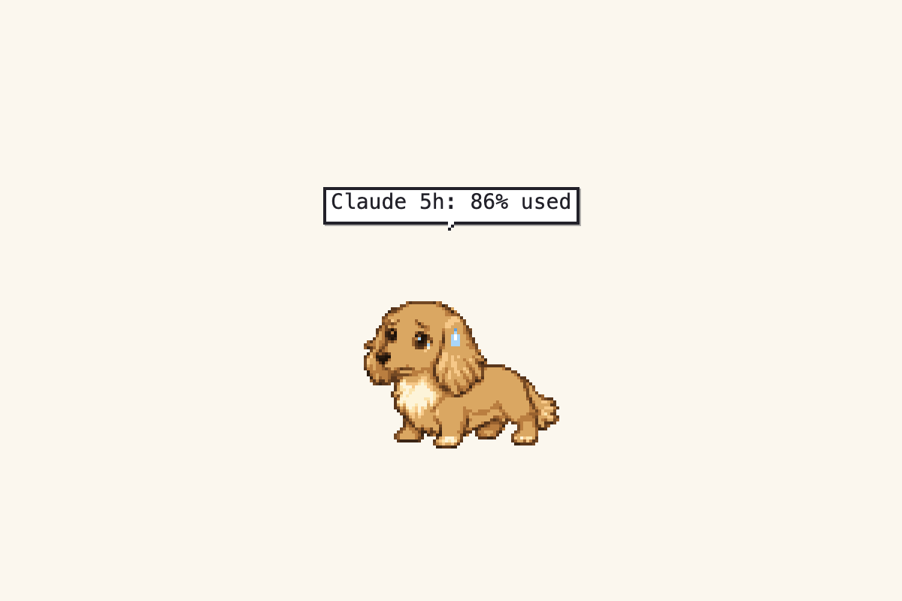
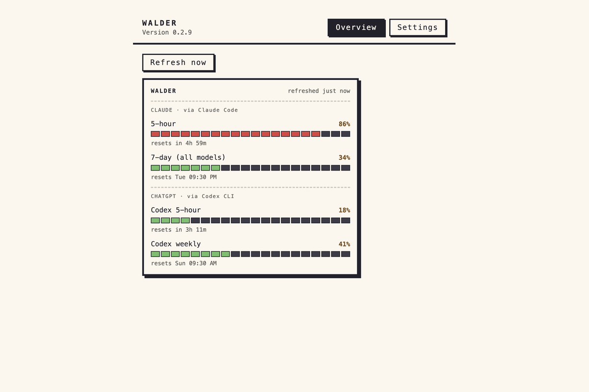

<p align="center">
  
</p>

<h1 align="center">Walder</h1>

<p align="center">
  A pixel-art dog on your desktop who watches your AI tools and tells you when one needs you, has finished, or is close to its usage limit.
</p>

<p align="center">
  <a href="https://github.com/ViuMP/Walder/releases/latest"></a>
  
  <a href="LICENSE"></a>
</p>

<p align="center">
  
</p>

<p align="center">
  <strong>Tracks Claude, ChatGPT and Codex, Cursor, GitHub Copilot and Gemini in one place.</strong><br>
  <strong>Barks when a usage window passes 80, 85, 90, 95 and 100 %.</strong><br>
  <strong>Shows when Claude Code or Codex is waiting for you, or has finished.</strong>
</p>

<p align="center"><sub>Screenshots are from macOS with sample numbers.</sub></p>

## Tracking


Hover over the dog and a card shows every usage window the services report, with the
percentage and when it resets. The numbers refresh every three minutes by default. His face
follows your Claude 5-hour window, from happy under 50 % to flat on the floor at 100 %. A service shows
numbers once Walder can read its login, and Gemini works on macOS only.

## Needs your input


When Claude Code or Codex stops to ask you something, he tilts his head, shows a question mark
and says `Claude waiting` or `Codex waiting`. Claude Code works with nothing installed.
Codex needs its hooks, installed from the bone menu, plus one step in Codex
([docs/hooks.md](docs/hooks.md)).

## Finished


When a reply lands, his ears go up and he says `Claude done` or `Codex done`. This works for the
command-line tools on the same computer. It does not cover the claude.ai or chatgpt.com
websites.

## Close to the limit



When a usage window passes 80, 85, 90, 95 or 100 %, he barks once with a bubble such as
`Claude 5h: 86% used`. Each threshold barks once per window, and the bubble stays until you
click him or the window resets. **Barks** in Settings changes the thresholds: Quiet barks at 95
and 100 %, Chatty every 10 %.

## The Walder window



**Overview and settings…** in the bone menu opens a normal window with two screens. Overview
shows the same card as the hover, plus a **Refresh now** button. Starting Walder again while it
runs opens this window too, from Finder or Spotlight on macOS. The window is new after version
0.2.9 and arrives with the next release. It is built for Windows as well, but has only been
checked on screen on macOS so far.

## Settings


Settings lists every setting Walder has, in six groups, with a line under each saying what it
does. Each change is checked and saved at once, and a value that is not allowed is refused with
the reason. Changes made in the bone menu show in the window, and the other way round.
Logins and hooks stay in the bone menu.

## Install

**macOS** (Apple Silicon, macOS 13 or newer):

```bash
curl -L -o ~/Downloads/Walder-mac-arm64.dmg https://github.com/ViuMP/Walder/releases/latest/download/Walder-mac-arm64.dmg && open ~/Downloads/Walder-mac-arm64.dmg
```

**Windows** (10 or 11, 64-bit), in PowerShell:

```powershell
Invoke-WebRequest https://github.com/ViuMP/Walder/releases/latest/download/Walder-win-x64.exe -OutFile "$env:USERPROFILE\Downloads\Walder-win-x64.exe"; Start-Process "$env:USERPROFILE\Downloads\Walder-win-x64.exe"
```

The apps are not signed with a paid certificate, so macOS and Windows each warn you once.
[INSTALL.md](INSTALL.md) has the steps past the warning, the first run, updating, uninstalling
and building from source.

## Settings reference

| Setting | What it does |
| --- | --- |
| Size | How big the dog is drawn: Small, Medium or Large. |
| Colour | The coat, from the coats in the sprite sheet. |
| Card size | How much the hover card shows: Large, Medium or Small. |
| Reset times | Reset times as a clock time or a countdown. |
| Still mode | Holds one frame per pose instead of animating. |
| Barks | Which usage levels raise a bubble: Quiet, Normal or Chatty. |
| Bark sound | Plays a short bark with each usage bubble. |
| Primary service | The service listed and reacted to first. |
| Notify when hidden | Sends a system notification when the dog is hidden and has something to say. |
| Show in overview | Which services appear on the card and may bark. |
| Hide when idle | Keeps the dog off screen until he has something to say. |
| Shortcut | The global shortcut that turns Hide when idle on and off. |
| Sleep during fullscreen video | Curls him up small while a fullscreen video or game is in front. |
| Refresh interval | Seconds between usage checks, from 180 to 86400. |
| Codex credit price | Price per Codex credit for the cost estimate on the card, or off. |
| Launch at login | Starts Walder when you log in. Installed app only. |
| Check for updates automatically | Asks GitHub every six hours whether a newer release exists. |
| Hook port | The local port the Claude Code and Codex hooks report to. |
| Verbose log | Writes detailed lines to the log file. |
| Force interactive | Makes the whole dog window take clicks, for debugging. |

Defaults, allowed values and where each one is stored: [SETTINGS.md](SETTINGS.md).

## FAQ

**Does Walder send my data anywhere?**
No. It talks only to the services it tracks and once every six hours to GitHub for the update
check. [docs/privacy.md](docs/privacy.md) lists every file it reads and every request it makes.

**Why does the dog look confused?**
Walder has no number for your Claude 5-hour window right now. Hover over him to see why, and log
in again from **Accounts** in the bone menu.

**Where is the dog?**
Bone menu ▸ **Reset position** puts him back in the bottom-right corner of your main screen.

**Is there an iPhone or iPad app?**
No. Walder runs on macOS and Windows.

**Why does macOS or Windows warn me when I install it?**
The apps are not signed with a paid certificate. [INSTALL.md](INSTALL.md) shows how to open it.

**How do I report a bug?**
Bone menu ▸ **Report a bug…** opens a draft GitHub issue with the details filled in. Nothing is
sent until you submit it. Security problems go to [SECURITY.md](SECURITY.md).

## License

The code is MIT: see [LICENSE](LICENSE). The dog and the other artwork are not. They are the
author's own illustration, all rights reserved, under [art/LICENSE](art/LICENSE).
