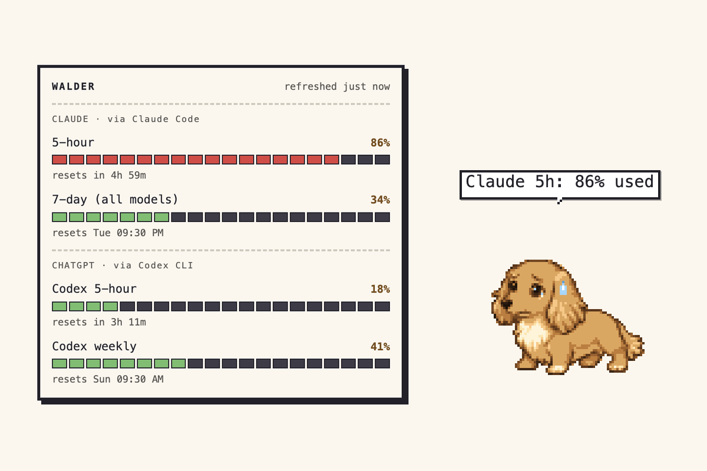
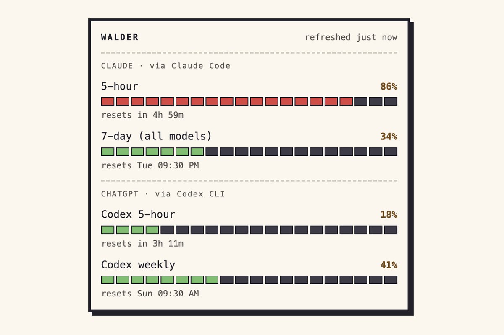
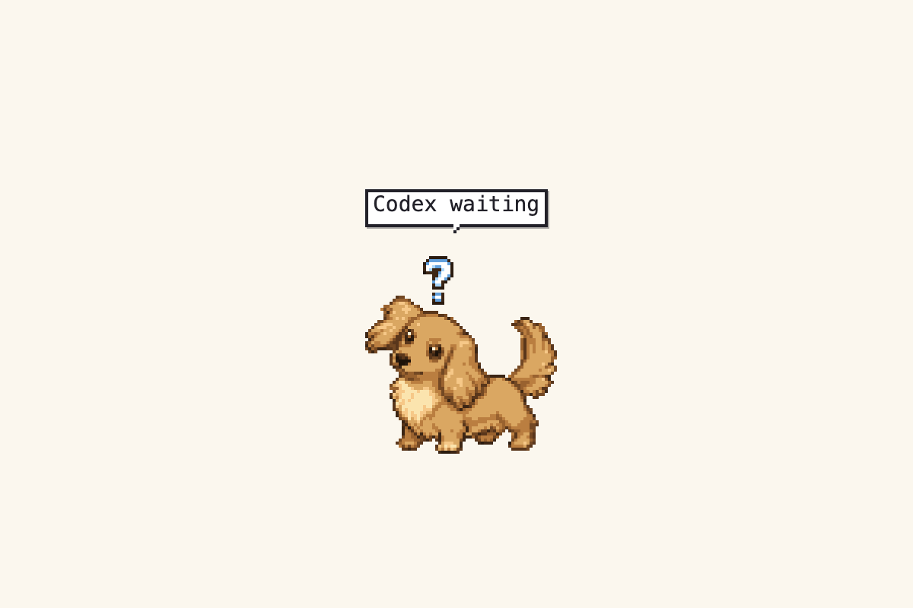
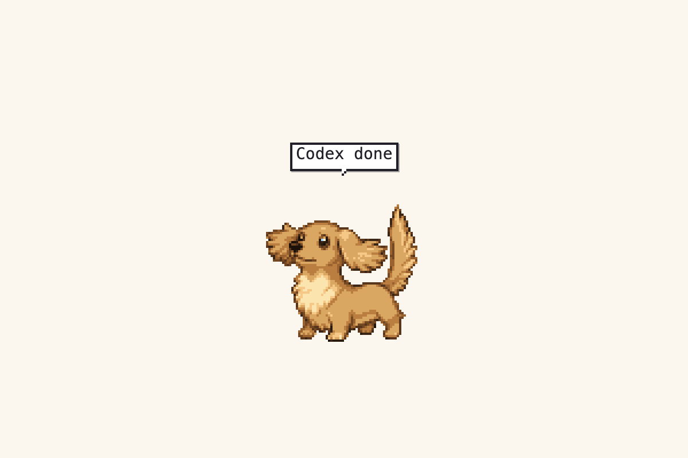
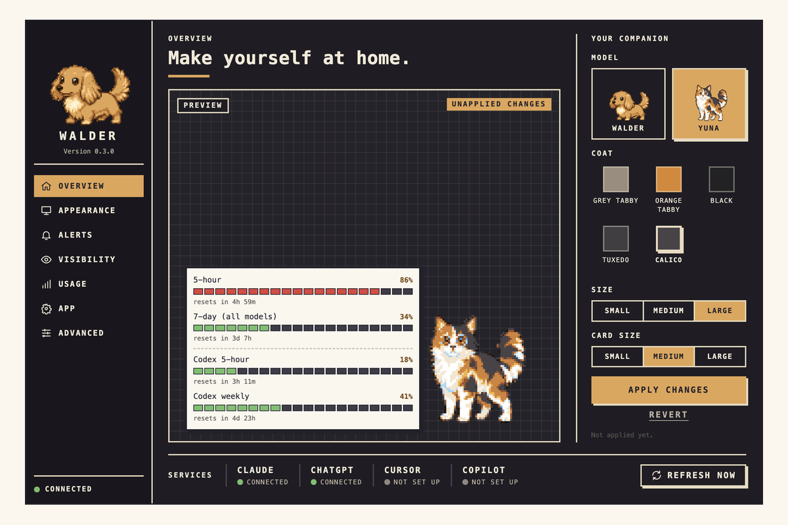
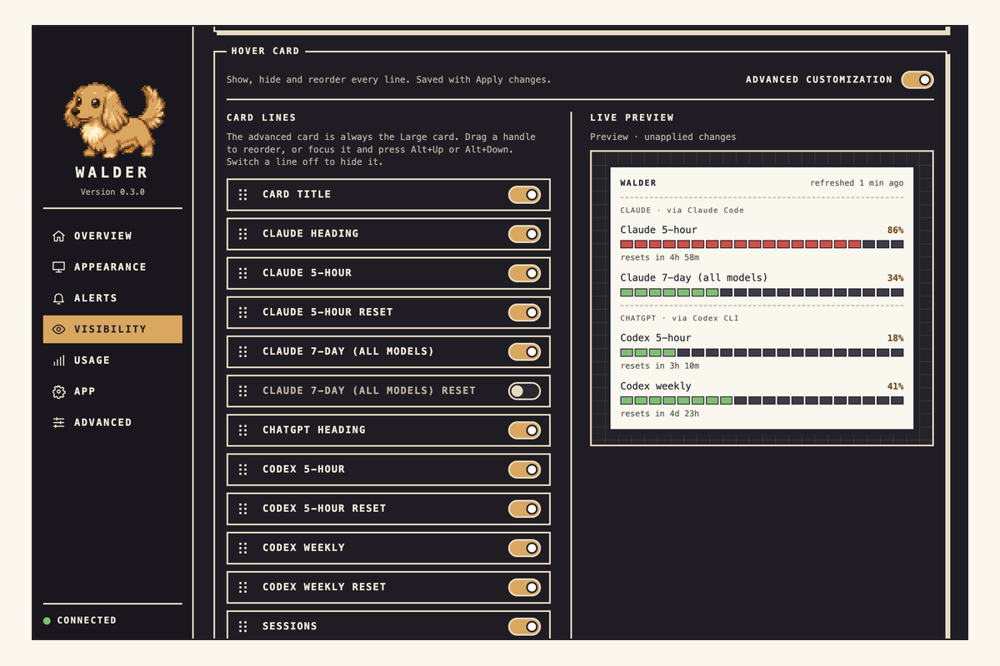
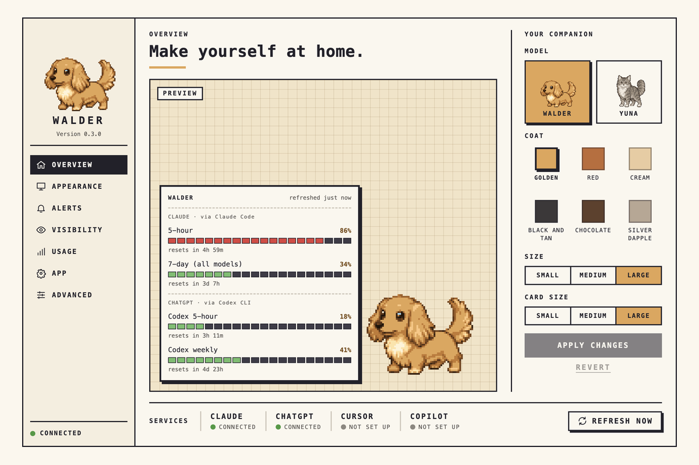
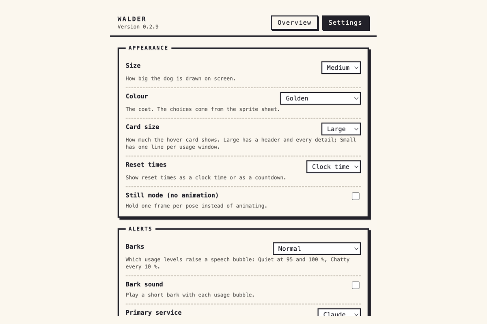
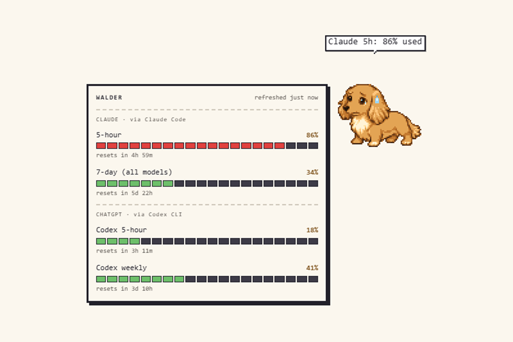
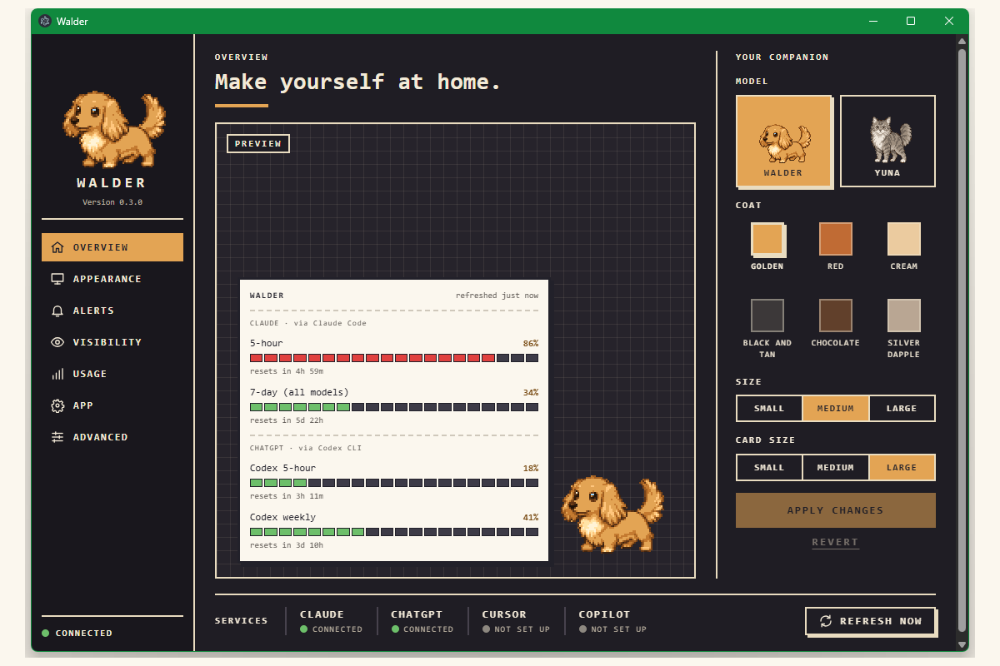

<p align="center">
  
</p>

<h1 align="center">Walder</h1>

<p align="center">
  A pixel-art dog on your desktop who shows your AI usage and tells you when a tool needs you, has finished, or is close to its limit.
</p>

<p align="center">
  <a href="https://github.com/ViuMP/Walder/releases/latest"></a>
  
  <a href="LICENSE"></a>
</p>

<p align="center">
  
</p>

<p align="center">
  <strong>Shows Claude, ChatGPT and Codex, Cursor, GitHub Copilot and Gemini usage on one card.</strong><br>
  <strong>Barks when a usage window nears its limit (80, 85, 90, 95 and 100 % by default).</strong><br>
  <strong>Tells you when Claude Code or Codex is waiting for you, or has finished.</strong>
</p>

<p align="center"><sub>Screenshots are from macOS with sample numbers. The same set from Windows is under <a href="#on-windows">On Windows</a>.</sub></p>

## Tracking



Hover over the dog and a card shows every usage window your services report, with the percentage
and when it resets. Claude and ChatGPT are read from your Claude Code and Codex CLI logins, or
from a login in Walder. Cursor comes from the signed-in Cursor editor, Copilot from the GitHub CLI,
and Gemini from the Antigravity IDE while it runs (on Windows not yet verified with a signed-in
account). The card comes Large, Medium
(no header) or Small (one line per window, no bars).

## Needs your input



When Claude Code or Codex stops to ask you something, he tilts his head, shows a question mark
and says `Claude waiting` or `Codex waiting`. Claude Code works with nothing installed. Codex
needs its hooks from the bone menu (**Hooks ▸ Install Codex hooks…**) plus one step in Codex
([docs/hooks.md](docs/hooks.md)).

## Finished



When a reply lands, his ears go up and he says `Claude done` or `Codex done`. This works for the
command-line tools on the same computer. It does not cover the claude.ai or chatgpt.com websites.

## Close to the limit


When a usage window passes 80, 85, 90, 95 or 100 %, he barks once with a bubble such as
`Claude 5h: 86% used`. Each level barks once per window. **Barks** changes the levels: Quiet
barks at 95 and 100%, Chatty every 10%. A service switched off in **Show in overview** does
not bark.

## The Walder window


**Overview and settings…** in the bone menu opens the Walder window. Starting Walder again while
it runs opens it too. A rail on the left lists Overview and one page per group of settings, and
Overview shows each service's state with **Refresh now**. Most settings save at once; only the
Overview choices and the hover card layout wait for **Apply changes**.

## Preview before you apply



On Overview you pick the model (Walder the dog or Yuna the cat), the coat, the size and the card
size. The preview shows the choice before it reaches your desktop. Nothing changes until you click
**Apply changes**, and closing the window drops a choice you did not apply.

## Your hover card, your way



**Advanced customization** (Visibility ▸ Hover card) turns the card into a list of lines. Drag a
line, or press Alt+Up or Alt+Down, to move it, and switch each one on or off. A live preview shows
the card before **Apply changes**, and **Restore default layout** puts every line back. The
advanced card is always the Large card, whatever Card size says.

## Light and dark



**Theme** (Appearance ▸ Theme) draws the Walder window light, dark, or following the system, which
is the default. It changes the Walder window only. The hover card and the dog look the same.

## Settings



Every setting has a control in the window, and on the settings pages each one has a line under it
that says what it does. Each change is checked before it is saved, and most are saved at once. Codex credit price and Hook port
take effect only after a restart, and a new Hook port also needs the hooks installed again. The
only settings still in the bone menu are Size and Hide when idle.

Walder speaks English, Danish, Simplified Chinese, Hindi, Spanish, French and German. **App ▸ Language**
follows your computer by default; a change applies after a restart. The six translations were
written by a machine and have not yet been read by a native speaker, so corrections are welcome as
[issues](https://github.com/ViuMP/Walder/issues/new). [docs/accessibility.md](docs/accessibility.md#language)
says what stays in English.

## On Windows





Walder looks and works the same on Windows (these were taken on Windows 11 at 100 %). The bone sits in the notification area
(it may be behind the ^ arrow until you drag it out), and right-clicking the dog opens the same
menu. The Walder window uses the normal Windows title bar. The rest of the Windows set, with the
same sample numbers, is in [assets/windows/](assets/windows/): the card on its own, the three
alerts, Preview before you apply, the hover card editor, the light theme and the Visibility page.

## Install

**macOS** (13 or newer). Apple Silicon (Apple menu ▸ About This Mac shows an "Apple M…" chip):

```bash
curl -L -o ~/Downloads/Walder-mac-arm64.dmg https://github.com/ViuMP/Walder/releases/latest/download/Walder-mac-arm64.dmg && open ~/Downloads/Walder-mac-arm64.dmg
```

Intel Mac (About This Mac shows an "Intel" processor). This build has not yet been tried on an
Intel Mac:

```bash
curl -L -o ~/Downloads/Walder-mac-x64.dmg https://github.com/ViuMP/Walder/releases/latest/download/Walder-mac-x64.dmg && open ~/Downloads/Walder-mac-x64.dmg
```

Drag **Walder.app** into **Applications** and open it. When macOS blocks it, click **Done**, then
**System Settings ▸ Privacy & Security ▸ Open Anyway**.

**Windows** (10 or 11, 64-bit), in PowerShell:

```powershell
Invoke-WebRequest https://github.com/ViuMP/Walder/releases/latest/download/Walder-win-x64.exe -OutFile "$env:USERPROFILE\Downloads\Walder-win-x64.exe"; Start-Process "$env:USERPROFILE\Downloads\Walder-win-x64.exe"
```

When SmartScreen warns you, click **More info**, then **Run anyway**. Tested on one Windows 11 PC
at 100 % and 125 % scaling, not yet on a second monitor.

The installers are not signed with a paid certificate, so each system warns you once.
[INSTALL.md](INSTALL.md) has every step, the first run, updating, uninstalling and building from
source. The [handbook](https://viump.github.io/Walder/) covers the first five minutes of setup
and every face, wiggle and bubble he has.

## Settings reference

| Setting | What it does |
| --- | --- |
| Overview ▸ Size | How big he is drawn: Small, Medium or Large. |
| Overview ▸ Model and Coat | Walder the dog or Yuna the cat, and the coat. |
| Overview ▸ Card size | How much the hover card shows: Large, Medium or Small. |
| Appearance ▸ Reset times | Reset times as a clock time or a countdown. |
| Appearance ▸ Still mode | Holds one frame per pose instead of animating. |
| Appearance ▸ Theme | The Walder window light, dark, or following the system. |
| Alerts ▸ Barks | Which usage levels raise a bubble: Quiet, Normal or Chatty. |
| Alerts ▸ Bark sound | Plays a short bark with each usage bubble. |
| Alerts ▸ Primary service | The service listed and reacted to first. |
| Alerts ▸ Notify when hidden | Sends a system notification when he is hidden and has something to say. |
| Visibility ▸ Show in overview | Which services appear on the card, may bark and are checked. A hidden service makes no requests. |
| Visibility ▸ Hover card | The standard card, or Advanced customization with your own lines. |
| Visibility ▸ Hide when idle | Keeps him off screen until he has something to say. |
| Visibility ▸ Shortcut | The global shortcut that turns Hide when idle on and off. |
| Visibility ▸ Sleep during fullscreen video | Curls him up small while a fullscreen video or game is in front. |
| Usage ▸ Refresh interval | Seconds between usage checks, from 180 to 86400. |
| Usage ▸ Codex credit price | The price per Codex credit for the cost on the card, or off. |
| App ▸ Language | System (follows your computer), English, Dansk, 简体中文, हिन्दी, Español, Français or Deutsch. After a restart. |
| App ▸ Launch at login | Starts Walder when you log in. Installed app only. |
| App ▸ Check for updates automatically | Asks GitHub every six hours whether a newer release exists. |
| App ▸ Hook port | The local port the Claude Code and Codex hooks report to. |
| Advanced ▸ Verbose log | Writes detailed lines to the log file. |
| Advanced ▸ Force interactive | Makes the whole dog window take clicks, for debugging. |

Defaults, allowed values and when each one takes effect: [SETTINGS.md](SETTINGS.md).

## FAQ

**Does Walder send my data anywhere?**
Only to the services it tracks, plus one request to GitHub every six hours for the update check.
There is no analytics or telemetry; [docs/privacy.md](docs/privacy.md) lists every request.

**Does it read my code or my prompts?**
No. It reads logins, usage numbers, session state and token counts, never a prompt or a reply
([docs/privacy.md](docs/privacy.md)).

**Why does macOS or Windows warn me when I install it?**
The installers are not signed with a paid certificate. [INSTALL.md](INSTALL.md) shows how to open
it.

**Why does Gemini show nothing?**
Walder reads Gemini limits from the Antigravity IDE while it runs, so open Antigravity and sign
in there. On Windows this is supported but not yet verified with a signed-in account.

**Does it update itself?**
No. When a newer release exists the bone menu and the dog say so, and you install it yourself;
**Check for updates automatically** turns the check off.

**How do I hide him?**
Turn on **Hide when idle** in the bone menu, or press its shortcut (Control+Command+W on macOS,
Alt+Shift+W on Windows). He comes back when he has something to say.

**Where is the dog?**
Bone menu ▸ **Reset position** puts him back in the bottom-right corner of your main screen.

**Does it speak my language?**
English, Danish, Simplified Chinese, Hindi, Spanish, French and German, chosen under App ▸ Language. The
translations are machine-made and still waiting for native speakers to check them.

**Does it work with a screen reader?**
Partly, and not yet tested. The dog, his bubbles and the card rows carry spoken labels, and Still
mode stops the animation, but nobody has run VoiceOver or Narrator through the Walder window yet.
[docs/accessibility.md](docs/accessibility.md) says what has and has not been checked.

## License

The code is MIT: see [LICENSE](LICENSE). The dog and the other artwork are not. They are the
author's own illustration, all rights reserved, under [art/LICENSE](art/LICENSE).
