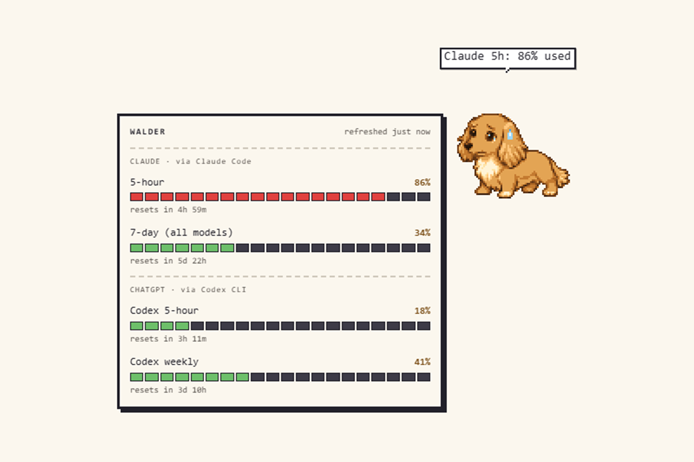
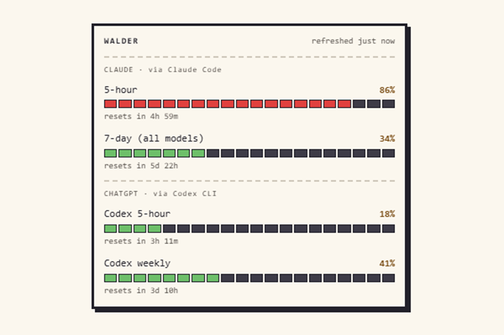
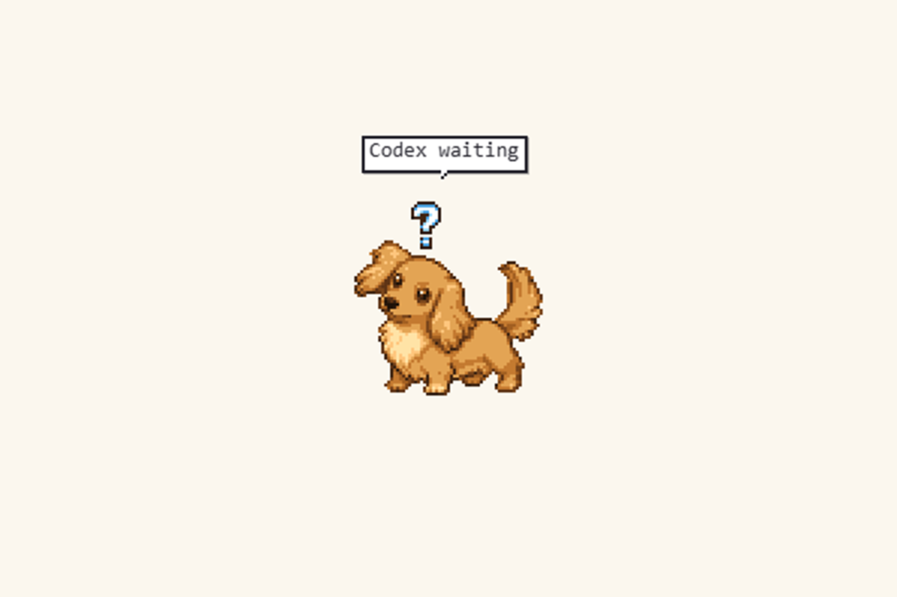
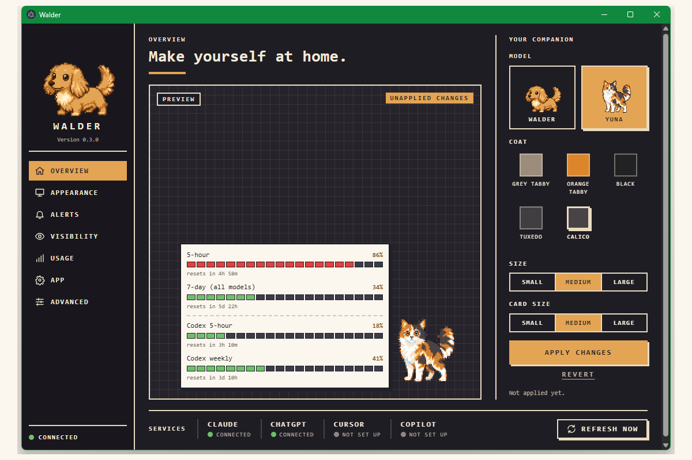
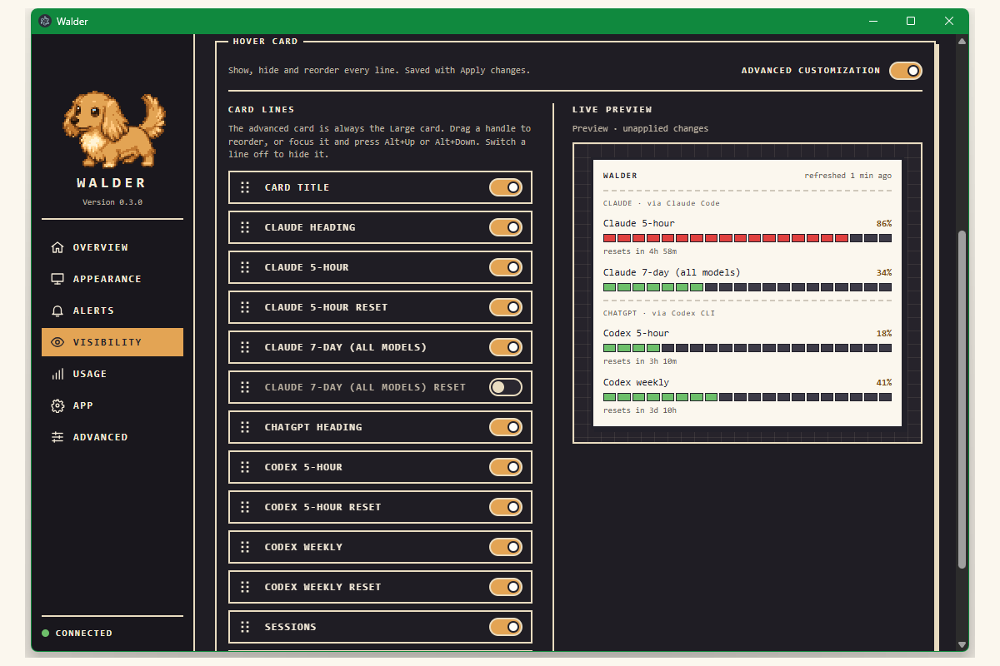
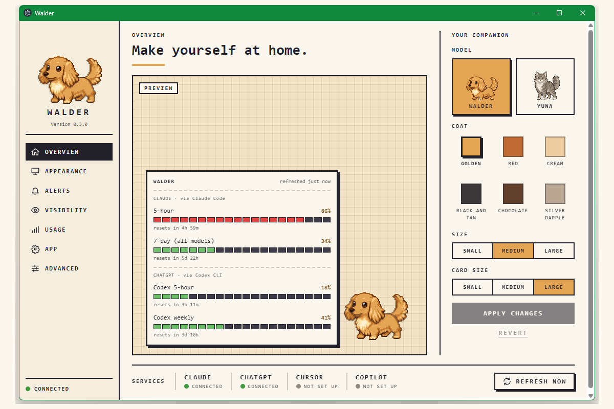
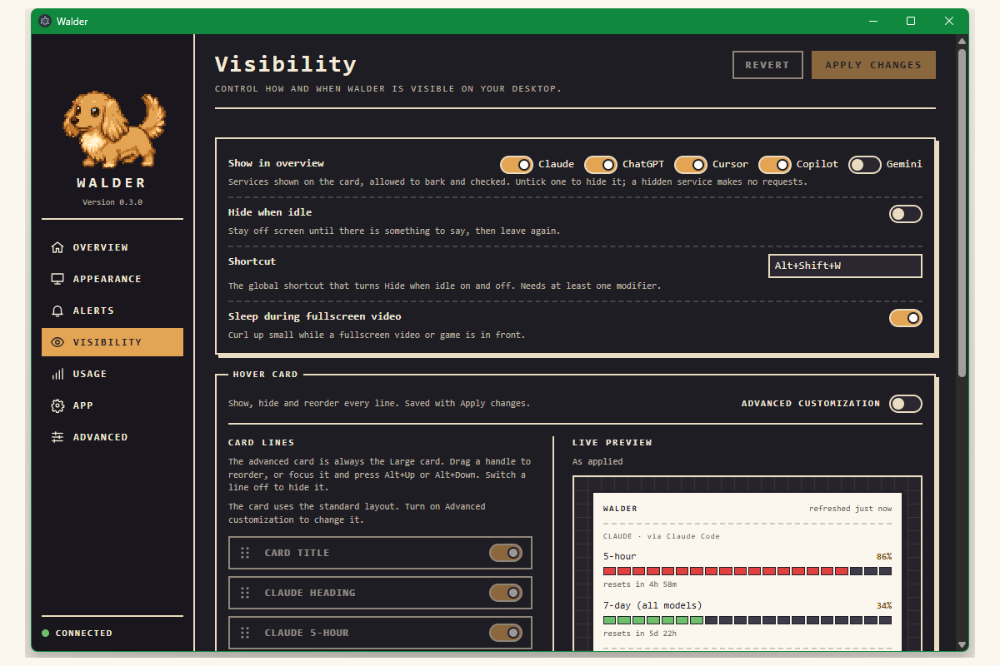

# Windows screenshots

The same set as `assets/macos/`, taken on Windows 11 at 100 % with the same sample numbers
(2026-11-18). The dog and card images are captures of the running app scaled up to 1200 × 800
on a plain background; the window images are the window at its own size.

